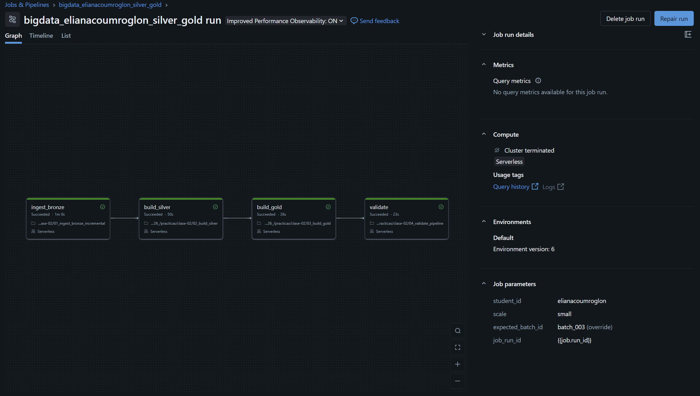

# Clase práctica 2 — Silver, Gold y orquestación

**Nombre:** Eliana Gómez Coumroglon

**student_id:** elianacoumroglon

**Escala:** small

**Job:** `bigdata_elianacoumroglon_silver_gold`

## DAG del Job

El Job tiene cuatro tareas encadenadas: `ingest_bronze` → `build_silver` → `build_gold` → `validate`.
Esta es la ejecución con `expected_batch_id = batch_003`:



## Resultados de las Ejecuciones

Resultados registrados en `pipeline_run_audit` para `batch_002`:

| Ejecución | job_run_id | silver_rows | quarantine_rows | gold_rows | gold_total_amount | idempotence_compared |
|---|---|---:|---:|---:|---:|---|
| Primera | 1046811749021782 | 50149 | 53 | 598 | 50286183.33 | false |
| Segunda | 284049704686572 | 50149 | 53 | 598 | 50286183.33 | true |

Las métricas son idénticas en las dos ejecuciones: reprocesar el mismo lote no duplicó ni perdió datos. La columna `idempotence_compared` pasa de `false` a `true`, lo que demuestra que la segunda corrida se comparó con la anterior.

Después se agregó `batch_003` y se ejecutó el Job con `expected_batch_id = batch_003`. 

## Aceptadas y rechazadas para `batch_002`

| Momento | Aceptadas | Rechazadas | Total |
|---|---:|---:|---:|
| Al ejecutar `batch_002` | 201 | 2 | 203 |
| Después de `batch_003` | 200 | 2 | 202 |

`batch_002` tiene 203 `transaction_id` distintos. Cuando se ejecutó, 201 fueron aceptados y 2 quedaron en cuarentena. La diferencia con las cifras actuales se debe a la transacción 42: `batch_003` trajo una versión más reciente, y por eso hoy `silver_transactions` la atribuye a `batch_003`. Las cifras actuales se obtuvieron de `silver_transactions` y `silver_transactions_quarantine`.

## Propósito

Transformar las tablas Bronze de la práctica 1 en datos confiables y productos analíticos. El flujo se ejecuta como un Lakeflow Job, admite archivos nuevos y demuestra idempotencia mediante validaciones automáticas.

## Por qué `COPY INTO` y `MERGE` resuelven problemas diferentes

`COPY INTO` resuelve la ingesta incremental de archivos: registra qué archivos físicos ya cargó en la tabla Bronze y omite los que ya procesó, de modo que reejecutar el Job no duplica filas. `MERGE` resuelve un problema distinto, el de las versiones de una misma transacción: en Silver compara por `transaction_id` y actualiza la fila solo si la versión que llega tiene un `updated_at` mayor, o la inserta si no existe. El primero evita cargar dos veces el mismo archivo; el segundo evita tener varias versiones de la misma transacción.

## Objetivos

- Aplicar contratos de tipos y reglas de calidad.
- Separar registros válidos de una cuarentena explicable.
- Resolver duplicados y correcciones con `MERGE`.
- Construir tablas Gold.
- Orquestar notebooks dependientes con Lakeflow Jobs.
- Probar una carga nueva sin cambiar el código del pipeline.
- Verificar reconciliación e idempotencia.

## Requisitos previos

La práctica 1 debe haber creado, en el mismo esquema:

```text
bronze_customers
bronze_products
bronze_transactions
bronze_events
```

Usá en todos los notebooks el mismo `student_id` y la misma escala de la práctica 1. Si trabajaste con `small`, no cambies a `test`: las claves foráneas se generan de acuerdo con la escala.

## Secuencia

1. Ejecutá `00_preflight.ipynb`.
2. Ejecutá manualmente `00_generate_new_batch.ipynb` con `batch_002`.
3. Creá el Job siguiendo `GUIA_CREAR_JOB.md`.
4. Ejecutá el Job con `expected_batch_id=batch_002`.
5. Revisá las cuatro tareas y las tablas resultantes.
6. Ejecutá nuevamente el mismo Job sin crear otro archivo.
7. Confirmá que la segunda validación informa métricas estables.
8. Volvé a ejecutar manualmente `00_generate_new_batch.ipynb`, esta vez con `batch_id=batch_003`.
9. Ejecutá el Job con `expected_batch_id=batch_003` y verificá que el nuevo lote aparezca en `gold_batch_summary`.
10. Ejecutá manualmente `05_visualizacion.ipynb` y resolvé las cuatro preguntas usando las tablas Gold.

### Qué hace `expected_batch_id`

El pipeline **no necesita** `expected_batch_id` para encontrar ni procesar archivos. La tarea de ingesta usa `COPY INTO` sobre el directorio de entrada, detecta automáticamente `batch_003` como un archivo nuevo y lo incorpora de manera incremental. Silver y Gold procesan después los datos resultantes sin requerir cambios en el código.

`expected_batch_id` se utiliza solamente en `04_validate_pipeline.ipynb`: expresa qué lote esperamos comprobar en esa ejecución. Al crear `batch_003`, cambiar el parámetro a `batch_003` permite validar que ese lote llegó a Bronze, fue aceptado o enviado a cuarentena, aparece en Gold y aplicó la corrección esperada.

Si se deposita `batch_003` pero se conserva `expected_batch_id=batch_002`, el ETL igualmente procesará el archivo nuevo. Sin embargo, la tarea `validate` puede fallar porque seguirá evaluando las expectativas de `batch_002` y comparando la corrida como si fuera una reejecución sin datos nuevos. El estado rojo representa entonces una expectativa de prueba incorrecta, no una incapacidad del pipeline para detectar el archivo.

## Tablas resultantes

```text
bronze_transactions_incremental
bronze_transactions_all       (vista)
silver_customers
silver_products
silver_transactions
silver_transactions_quarantine
gold_daily_sales
gold_customer_risk
gold_batch_summary
pipeline_run_audit
```

## Preguntas de análisis y comprensión

Respondé las siguientes preguntas después de completar las ejecuciones con `batch_002` y `batch_003`. En las preguntas de análisis incluí la consulta SQL o PySpark utilizada y el resultado relevante. En las preguntas sobre código, indicá el notebook y la sección que fundamentan tu respuesta.

### Análisis de las tablas

1. ¿Cuántas filas físicas recibió cada lote en `bronze_transactions_incremental`? Escribí una consulta que muestre el resultado por `source_batch_id`.

```sql
 SELECT source_batch_id,
       COUNT(*)                       AS filas_fisicas,
       COUNT(DISTINCT transaction_id) AS ids_distintos
FROM bronze_transactions_incremental
GROUP BY source_batch_id
ORDER BY source_batch_id;
```

Cada lote incremental recibió 204 filas físicas: batch_002 y batch_003 tienen 204 cada uno. En ambos lotes hay solo 203 transaction_id distintos, es decir, una fila repetida por lote. Esa diferencia de 1 corresponde a un transaction_id que llegó duplicado dentro del mismo archivo, y es el tipo de caso que Silver resuelve con la deduplicación por _record_key y row_number. La carga inicial no aparece en esta tabla porque corresponde a la tabla Bronze inicial, no a bronze_transactions_incremental.

2. Para cada lote, ¿cuántas transacciones fueron aceptadas y cuántas quedaron en `silver_transactions_quarantine`? Reconciliá tus resultados con `gold_batch_summary`.

```sql
WITH aceptadas AS (
    SELECT source_batch_id,
           COUNT(*) AS aceptadas_silver,
           COUNT(DISTINCT transaction_id) AS ids_aceptadas
    FROM workspace.bigdata_elianacoumroglon.silver_transactions
    GROUP BY source_batch_id
),
cuarentena AS (
    SELECT source_batch_id,
           COUNT(*) AS cuarentena_silver,
           COUNT(DISTINCT transaction_id) AS ids_cuarentena
    FROM workspace.bigdata_elianacoumroglon.silver_transactions_quarantine
    GROUP BY source_batch_id
),
gold AS (
    SELECT source_batch_id,
           SUM(accepted_transactions) AS aceptadas_gold,
           SUM(rejected_transactions) AS rechazadas_gold
    FROM workspace.bigdata_elianacoumroglon.gold_batch_summary
    GROUP BY source_batch_id
)
SELECT COALESCE(a.source_batch_id, c.source_batch_id, g.source_batch_id) AS source_batch_id,
       COALESCE(a.aceptadas_silver, 0)  AS aceptadas_silver,
       COALESCE(a.ids_aceptadas, 0)     AS ids_aceptadas,
       COALESCE(c.cuarentena_silver, 0) AS cuarentena_silver,
       COALESCE(c.ids_cuarentena, 0)    AS ids_cuarentena,
       g.aceptadas_gold,
       g.rechazadas_gold,
       COALESCE(a.aceptadas_silver, 0)  - g.aceptadas_gold  AS dif_aceptadas,
       COALESCE(c.cuarentena_silver, 0) - g.rechazadas_gold AS dif_rechazadas,
       CASE WHEN COALESCE(a.aceptadas_silver, 0)  = g.aceptadas_gold
             AND COALESCE(c.cuarentena_silver, 0) = g.rechazadas_gold
            THEN 'OK' ELSE 'REVISAR' END AS reconciliacion
FROM aceptadas a
FULL OUTER JOIN cuarentena c ON a.source_batch_id = c.source_batch_id
FULL OUTER JOIN gold g
       ON COALESCE(a.source_batch_id, c.source_batch_id) = g.source_batch_id
ORDER BY source_batch_id;
```

En el lote initial se aceptaron 49,948 transacciones y 51 quedaron en silver_transactions_quarantine; en batch_002 fueron 200 y 2, y en batch_003 fueron 201 y 2. Estas cifras coinciden exactamente con accepted_transactions y rejected_transactions de gold_batch_summary en los tres lotes, por lo que Silver y Gold están reconciliados. La suma de aceptadas y rechazadas no coincide con las 203 `transaction_id` distintas de la P1 en `batch_002` (200 + 2 = 202). El id que falta es la transacción 42, cuya versión de `batch_002` fue reemplazada por la de `batch_003`, de modo que hoy Silver la cuenta en `batch_003` (201 + 2 = 203).

3. ¿Qué motivos de rechazo aparecen en la cuarentena y cuántos registros tiene cada uno por lote? ¿Los rechazos observados coinciden con los casos introducidos por el generador?

```sql
SELECT quality_reason,
       SUM(CASE WHEN source_batch_id = 'initial'   THEN 1 ELSE 0 END) AS initial,
       SUM(CASE WHEN source_batch_id = 'batch_002' THEN 1 ELSE 0 END) AS batch_002,
       SUM(CASE WHEN source_batch_id = 'batch_003' THEN 1 ELSE 0 END) AS batch_003,
       COUNT(*) AS total
FROM workspace.bigdata_elianacoumroglon.silver_transactions_quarantine
GROUP BY quality_reason
ORDER BY total DESC;
```

| quality_reason | initial | batch_002 | batch_003 | total |
|---|---:|---:|---:|---:|
| INVALID_AMOUNT | 51 | 1 | 1 | 53 |
| UNKNOWN_CUSTOMER | 0 | 1 | 1 | 2 |

Aparecen dos motivos de rechazo. `INVALID_AMOUNT` concentra casi todo el volumen (53 de 55 registros), sobre todo por los 51 casos de la carga `initial`. `UNKNOWN_CUSTOMER` no aparece en `initial` y tiene 1 caso en cada lote incremental. Cada lote incremental aporta entonces exactamente 2 rechazos: 1 por importe inválido y 1 por cliente inexistente.

Esos rechazos coinciden con los casos que introduce el generador de lotes (`00_generate_new_batch.ipynb`): en cada lote incremental inyecta un registro con importe inválido y otro con un cliente que no existe, y ambos terminan en cuarentena con el motivo esperado. Los casos restantes del generador (la fila duplicada y la corrección de la transacción 42) no son rechazos: Silver los resuelve con la deduplicación y el `MERGE`.

4. Seguí la transacción `42` desde `bronze_transactions_all` hasta `silver_transactions`. ¿Cuántas versiones existen en Bronze y cuál quedó vigente en Silver? Mostrá las columnas que justifican la elección.

```sql
SELECT transaction_id, source_batch_id, updated_at, amount, payment_channel,
       is_fraud, customer_id, product_id, event_ts, processed_at
FROM workspace.bigdata_elianacoumroglon.silver_transactions
WHERE transaction_id = 42;
```

La transacción 42 tiene 3 versiones en bronze_transactions_all, una en cada lote (initial, batch_002 y batch_003), con cambios en monto, canal y marca de fraude (0 a 1). 
En silver_transactions quedó una sola fila, la del lote batch_003, porque tiene el updated_at más reciente (2026-03-11 02:00:00). Silver conserva entonces la última versión de cada transacción y descarta las anteriores.
La versión de batch_002 de la transacción 42 dejó de contar como aceptada en ese lote cuando batch_003 la reemplazó (ver P2).

5. Comprobá mediante una consulta que `silver_transactions` tiene una sola fila por `transaction_id`. ¿Qué resultado indicaría que la deduplicación falló?

```sql
SELECT COUNT(*) AS filas,
       COUNT(DISTINCT transaction_id) AS ids_distintos,
       COUNT(*) - COUNT(DISTINCT transaction_id) AS filas_sobrantes,
       SUM(CASE WHEN transaction_id IS NULL THEN 1 ELSE 0 END) AS ids_nulos
FROM workspace.bigdata_elianacoumroglon.silver_transactions;

SELECT transaction_id,
       COUNT(*) AS apariciones,
       COLLECT_SET(source_batch_id) AS lotes
FROM workspace.bigdata_elianacoumroglon.silver_transactions
GROUP BY transaction_id
HAVING COUNT(*) > 1
ORDER BY apariciones DESC;
```

silver_transactions tiene 50349 filas y 50349 transaction_id distintos, sin ids nulos, por lo que existe una sola fila por transacción. 
Si la deduplicación hubiera fallado, la consulta de duplicados devolvería filas y el conteo de filas superaría al de ids distintos.    

6. Calculá la tasa de rechazo de cada lote como `rechazadas / (aceptadas + rechazadas)` en `gold_batch_summary`. ¿Es correcto comparar solamente las cantidades absolutas si los lotes tienen tamaños diferentes?

```sql
SELECT source_batch_id,
       SUM(accepted_transactions) AS aceptadas,
       SUM(rejected_transactions) AS rechazadas,
       SUM(accepted_transactions) + SUM(rejected_transactions) AS total,
       ROUND(100 * SUM(rejected_transactions)
             / (SUM(accepted_transactions) + SUM(rejected_transactions)), 3) AS tasa_rechazo_pct
FROM workspace.bigdata_elianacoumroglon.gold_batch_summary
GROUP BY source_batch_id
ORDER BY source_batch_id;
```

La tasa de rechazo es 0.102% en initial (51 de 49,999), 0.990% en batch_002 (2 de 202) y 0.985% en batch_003 (2 de 203). Diría que no es correcto comparar solo cantidades absolutas, porque los lotes tienen tamaños muy distintos: initial tiene más rechazos en cantidad, pero una tasa mucho menor. 

7. ¿Qué día presenta el mayor monto total y cuál presenta la mayor cantidad de transacciones? Consultá `gold_daily_sales` y explicá si ambos máximos coinciden.

7)a) Los dos días máximos

```sql
WITH diario AS (
    SELECT sale_date,
           SUM(total_amount)      AS monto_total,
           SUM(transaction_count) AS transacciones
    FROM workspace.bigdata_elianacoumroglon.gold_daily_sales
    GROUP BY sale_date
)
SELECT 'mayor monto' AS criterio, sale_date, monto_total, transacciones,
       ROUND(monto_total / transacciones, 2) AS ticket_promedio
FROM (SELECT * FROM diario ORDER BY monto_total DESC LIMIT 1)
 
UNION ALL
 
SELECT 'mayor cantidad de transacciones', sale_date, monto_total, transacciones,
       ROUND(monto_total / transacciones, 2)
FROM (SELECT * FROM diario ORDER BY transacciones DESC LIMIT 1);
```
 
b) Ticket promedio de todo el período

```sql
SELECT ROUND(SUM(total_amount) / SUM(transaction_count), 2) AS ticket_promedio_periodo
FROM workspace.bigdata_elianacoumroglon.gold_daily_sales;
```

El mayor monto total se registró el 2026-03-01 (7310840.77) y la mayor cantidad de transacciones el 2026-03-01 (7236). Los máximos coinciden. El ticket promedio de ese día fue $1010.34, frente a $1001.63 en todo el período, lo que indica que el récord de ventas se debe al volumen de operaciones.

8. ¿Qué canal de pago tiene la mayor tasa global de fraude? Calculala como `SUM(fraud_transactions) / SUM(transaction_count)` y explicá por qué no corresponde promediar directamente `fraud_rate`.

```sql
SELECT payment_channel,
       SUM(transaction_count)  AS transacciones,
       SUM(fraud_transactions) AS fraudes,
       ROUND(100 * SUM(fraud_transactions) / SUM(transaction_count), 3) AS tasa_global_pct,
       ROUND(100 * AVG(fraud_rate), 3) AS promedio_fraud_rate_pct
FROM workspace.bigdata_elianacoumroglon.gold_daily_sales
GROUP BY payment_channel
ORDER BY tasa_global_pct DESC;
```

El canal de pago que tiene la mayor tasa global de fraude es 'tranfer' (13.91%). La tasa global se calcula como SUM(fraud_transactions) / SUM(transaction_count) porque promediar fraud_rate trataría de la misma forma a casos que tiene volumenes muy altos o muy bajos. La suma ponderada refleja la proporción real de fraudes de cada canal.

9. ¿Qué combinación de país y categoría concentra el mayor monto vendido? Mostrá también la combinación líder dentro de cada país.

-- 9a) Combinación líder global
```sql
SELECT country, category,
       SUM(total_amount) AS monto_total
FROM workspace.bigdata_elianacoumroglon.gold_daily_sales
GROUP BY country, category
ORDER BY monto_total DESC
LIMIT 1;
```
 
-- 9b) Categoría líder dentro de cada país
```sql
WITH pc AS (
    SELECT country, category,
           SUM(total_amount) AS monto_total
    FROM workspace.bigdata_elianacoumroglon.gold_daily_sales
    GROUP BY country, category
),
ranking AS (
    SELECT *,
           SUM(monto_total) OVER (PARTITION BY country) AS monto_pais,
           RANK() OVER (PARTITION BY country ORDER BY monto_total DESC) AS pos
    FROM pc
)
SELECT country, category AS categoria_lider, monto_total,
       ROUND(100 * monto_total / monto_pais, 1) AS pct_del_pais
FROM ranking
WHERE pos = 1
ORDER BY monto_total DESC;
```

La combinación que concentra el mayor monto vendido es BR-home ($2361959.97). Dentro de cada país, la categoría líder es distinta según el país: UY-home (22.3% de participación), AR-books (22.7% de participación), MX-books (22.8% de participación) y CL-home (22.0% de participación).

10. Compará las dos primeras filas de `pipeline_run_audit` correspondientes a la reejecución de `batch_002`. ¿Qué métricas permanecen iguales y qué columna demuestra que se realizó la comparación de idempotencia?

-- 10a) Esquema
```sql
DESCRIBE workspace.bigdata_elianacoumroglon.pipeline_run_audit;
```
 
-- 10b) Contenido completo (la tabla suele ser chica)
```sql
SELECT *
FROM workspace.bigdata_elianacoumroglon.pipeline_run_audit;
```

En las dos primeras filas de pipeline_run_audit para batch_002 permanecen iguales silver_rows (50,149), quarantine_rows (53), gold_rows (598) y gold_total_amount (50,286,183.33). Solo cambian job_run_id y recorded_at, que identifican cada corrida.  La columna idempotence_compared demuestra que se realizó la comparación: vale false en la primera corrida, que no tiene una anterior con qué compararse, y true en la reejecución.

### Interpretación del código y del pipeline

11. En `01_ingest_bronze_incremental.ipynb`, ¿qué problema resuelve `COPY INTO` y qué información utiliza para evitar cargar dos veces el mismo archivo físico?

`COPY INTO` carga archivos en una tabla Delta de forma idempotente. Para no cargar dos veces el mismo archivo físico usa el registro de rutas de archivos ya cargados que mantiene en los metadatos de la tabla destino: en cada ejecución compara los archivos del directorio contra ese registro e ingiere solo los nuevos. Sin esto, cada corrida volvería a leer todos los archivos y duplicaría las filas en Bronze.

**Notebook y sección:** `01_ingest_bronze_incremental`, celda del COPY INTO (el markdown que dice que registra qué archivos ya procesó).

12. ¿Por qué la vista `bronze_transactions_all` usa `UNION ALL` en lugar de eliminar duplicados? ¿En qué capa se resuelven los duplicados de negocio y por qué?

La vista bronze_transactions_all usa UNION ALL porque Bronze debe conservar todo lo que llegó, sin transformar ni descartar nada. Además, UNION ALL mantiene el historial completo y la trazabilidad por lote: la transacción 42 tiene 3 versiones en Bronze, una por lote (initial, batch_002 y batch_003). 
Los duplicados de negocio se resuelven en la capa Silver, que se queda con la versión más reciente de cada transaction_id según updated_at (para la 42, la de batch_003). Se hace ahí porque Silver es la capa de limpieza y validación, y porque así Bronze sigue siendo una copia fiel de la fuente que permite reprocesar y auditar.

**Notebook y sección:** `01_ingest_bronze_incremental`, celda donde se crea la vista bronze_transactions_all con UNION ALL.

13. ¿Por qué las transacciones iniciales reciben `source_batch_id='initial'` y usan `event_ts` como `updated_at`? ¿Cómo afecta eso a la corrección de la transacción `42`?

Las transacciones iniciales reciben source_batch_id = 'initial' para identificar su origen: son la carga base, anterior a los lotes incrementales, y ese valor permite rastrear de qué lote viene cada fila. Usan event_ts como updated_at porque la carga inicial no trae una marca de actualización propia, y el pipeline necesita que toda fila tenga una fecha de versión para decidir cuál es la más reciente. 
La primera versión de una transacción “se actualizó” cuando ocurrió. Esto afecta a la transacción 42 porque su versión inicial queda con updated_at = 2026-03-06 02:07:52, anterior a las correcciones de batch_002 (2026-03-10) y batch_003 (2026-03-11). Como Silver conserva la fila con el updated_at más reciente, las correcciones reemplazan a la original y queda vigente la de batch_003. Si la versión inicial tuviera un updated_at posterior o nulo, la regla podría elegir mal y la corrección no se aplicaría.

**Notebook y sección:** `01_ingest_bronze_incremental`, celda donde se asigna source_batch_id = 'initial' y event_ts como updated_a.

14. En `quality_rules.py`, ¿qué ventaja ofrece `try_cast` frente a un `cast` convencional cuando llega un importe como `N/A`?

Con un cast convencional, un importe como N/A no se puede convertir a DECIMAL(12,2) y, con ANSI activado, lanza un error que haría fallar toda la ejecución por un solo registro. try_cast devuelve NULL cuando la conversión no es posible, sin interrumpir el proceso. En quality_rules.py se usa para generar amount_typed y luego la regla de calidad detecta amount_typed IS NULL OR amount_typed <= 0 y asigna INVALID_AMOUNT. Así el registro malo va a cuarentena con su motivo y el resto del lote sigue hacia Silver.

**Notebook y sección:** `quality_rules.py`, funciones donde están try_cast y la cadena de when(...).

15. Las reglas de calidad asignan una única `quality_reason`. ¿Qué sucede si un registro viola más de una regla y por qué importa el orden de las condiciones?

add_quality_reason encadena condiciones when(...) y Spark asigna la primera que se cumple, por lo que cada registro recibe una sola quality_reason aunque viole varias reglas. El registro va a cuarentena igual, pero el motivo registrado depende del orden. En este código el orden es: ids y fechas inválidos, luego importe, canal de pago, marca de fraude, updated_at, y al final los motivos referenciales UNKNOWN_CUSTOMER y UNKNOWN_PRODUCT. Por eso un registro con importe inválido y cliente desconocido figura como INVALID_AMOUNT, y el segundo problema queda oculto. Importa además por una dependencia lógica: no se puede verificar si un cliente existe si su customer_id ni siquiera se pudo convertir, así que INVALID_CUSTOMER_ID va antes que UNKNOWN_CUSTOMER.

**Notebook y sección:** `quality_rules.py`, funciones donde están try_cast y la cadena de when(...).

16. Explicá cómo se construye `_record_key` y cómo se usa junto con `row_number`. ¿Qué caso cubre el hash cuando `transaction_id` no puede convertirse a un número?

_record_key es la clave que identifica a cada registro. Si transaction_id se puede convertir a número, la clave es ese número. Si no se puede, la clave es un hash SHA-256 de todas las columnas originales concatenadas.
Después, row_number() agrupa las filas por _record_key, las ordena por updated_at de más reciente a más antigua y se queda solo con la primera. Así queda una sola versión por transacción, como la de batch_003 para la 42.
El hash cubre el caso en que transaction_id no es un número. Sin él, la clave sería NULL para todos esos registros, row_number los trataría como un solo grupo y conservaría uno solo, descartando el resto sin mandarlo a cuarentena. Con el hash, cada registro inválido distinto tiene su propia clave y llega a cuarentena como INVALID_TRANSACTION_ID.

**Notebook y sección:** `02_build_silver`, sección de deduplicación con _record_key y row_number.

17. Interpretá las dos cláusulas principales del `MERGE` de `silver_transactions`. ¿Cuándo se actualiza una fila existente y cuándo se inserta una nueva?

El MERGE de silver_transactions compara cada fila válida con la tabla por transaction_id. En WHEN MATCHED AND s.updated_at > t.updated_at, si la transacción ya existe y la versión nueva tiene un updated_at estrictamente mayor, se actualiza la fila existente (UPDATE SET *). En WHEN NOT MATCHED, si la transacción no existe en Silver, se inserta como fila nueva (INSERT *). Si existe pero la versión que llega no es más reciente, no se hace nada. Los registros rechazados no entran a este MERGE: se envían a silver_transactions_quarantine con otro MERGE que solo inserta (WHEN NOT MATCHED) cuando no existe ya un rechazo con el mismo transaction_id, lote y motivo. Con ambos MERGE, reejecutar el notebook no duplica filas ni en Silver ni en cuarentena.

**Notebook y sección:** `02_build_silver`, sección del MERGE de silver_transactions y el de cuarentena.

18. ¿Por qué las tablas Gold se reconstruyen completamente en esta práctica mientras Silver se actualiza con `MERGE`? Mencioná una ventaja y una limitación de cada estrategia.

Las tablas Gold se reconstruyen completas porque son agregados derivados de Silver. En gold_customer_risk, por ejemplo, se usa CREATE OR REPLACE TABLE ... AS, que recalcula todas las métricas por cliente (cantidad de transacciones, monto total y promedio, dispositivos distintos, fraudes) y el risk_level desde Silver en cada ejecución. Una sola transacción corregida puede cambiar las sumas, los promedios y el nivel de riesgo de un cliente, y recalcular todo garantiza que el resultado sea consistente con el estado actual de Silver sin tener que identificar qué agregados cambiaron. Silver, en cambio, guarda registros individuales con clave única (transaction_id), así que se actualiza solo lo que cambió con MERGE.
Reconstrucción completa (Gold):

Ventaja: es simple y confiable. El resultado siempre refleja Silver actual, y reejecutar da el mismo resultado.
Limitación: recalcula todo aunque cambie poco, así que su costo crece con el volumen de datos.

MERGE (Silver):

Ventaja: procesa solo lo nuevo o modificado y conserva una sola versión por transacción, sin reescribir toda la tabla.
Limitación: es más complejo, porque necesita una clave única y una regla de actualización (updated_at), y una condición mal definida puede dejar versiones desactualizadas.

**Notebook y sección:** `03_build_gold y 02_build_silver`, CREATE OR REPLACE TABLE ... AS de Gold y el MERGE de Silver.

19. ¿Por qué `expected_batch_id` no participa en la detección del archivo nuevo? Indicá qué parte del pipeline descubre `batch_003` y qué parte utiliza el parámetro.

`expected_batch_id` no participa en la detección del archivo nuevo porque la ingesta usa `COPY INTO` sobre el directorio de entrada: lee la carpeta, detecta automáticamente los archivos que todavía no cargó (por ejemplo `batch_003`) y los incorpora, sin necesitar el nombre del lote. Quien descubre `batch_003` es la tarea `ingest_bronze` (notebook `01_ingest_bronze_incremental`). El parámetro se usa solamente en la tarea `validate` (notebook `04_validate_pipeline`), donde indica qué lote se espera comprobar: que llegó a Bronze y a Silver, que tiene rechazos controlados, que aparece en `gold_batch_summary` y que la corrección de la transacción 42 viene de ese lote. Si se carga `batch_003` pero el parámetro sigue en `batch_002`, el ETL procesa igual el archivo nuevo, pero `validate` falla: en mi ejecución falló el control `historical_correction_applied`.

20. Si la tarea `build_silver` falla, ¿qué ocurre con `build_gold` y `validate` en el Job? Explicá cómo las dependencias del DAG evitan publicar o validar resultados incompletos.

Si build_silver falla, build_gold y validate no se ejecutan: Databricks las marca como “Upstream failed” (omitidas por falla de una tarea anterior). Esto ocurre porque cada tarea declara de qué tareas depende y, por defecto, solo corre cuando todas sus dependencias terminaron con éxito. Así, las tablas Gold no se reconstruyen sobre un Silver que quedó incompleto o desactualizado, y validate no da por buena una corrida que no terminó. Las dependencias del DAG ordenan el flujo (Bronze, Silver, Gold, validación) y funcionan como una barrera: ningún resultado se publica ni se valida sin que la etapa previa haya terminado bien.    

## Duración estimada

| Bloque | Minutos |
|---|---:|
| Repaso y preflight | 15 |
| Contratos, calidad y cuarentena | 25 |
| Silver y `MERGE` | 30 |
| Pausa | 10 |
| Gold y reconciliación | 25 |
| Construcción del Job | 25 |
| Archivo nuevo y primera ejecución | 20 |
| Segunda ejecución y cierre | 10 |
| Visualización orientada a preguntas | 20 |

## Entrega

La publicación, el acceso público y el envío a los profesores siguen el [formato común de entrega](../README.md#formato-común-de-entrega).

En tu repositorio personal creá `resolucion-practica-2/` con:

```text
resolucion-practica-2/
├── README.md
├── 02_build_silver.ipynb
├── 03_build_gold.ipynb
├── 04_validate_pipeline.ipynb
└── 05_visualizacion.ipynb
```

El `README.md` debe incluir:

- Nombre, `student_id` y escala.
- Captura del DAG del Job con las cuatro tareas.

- URL del Job o su nombre exacto.
- Resultados de la primera y segunda ejecución.
- Cantidades aceptadas y rechazadas para `batch_002`.
- Explicación breve de por qué `COPY INTO` y `MERGE` resuelven problemas diferentes.
- Las cuatro visualizaciones y una respuesta explícita para cada pregunta.
- Respuestas a las 20 preguntas de análisis y comprensión, incluyendo las consultas utilizadas cuando corresponda.

No incluyas datos, credenciales ni tokens.

