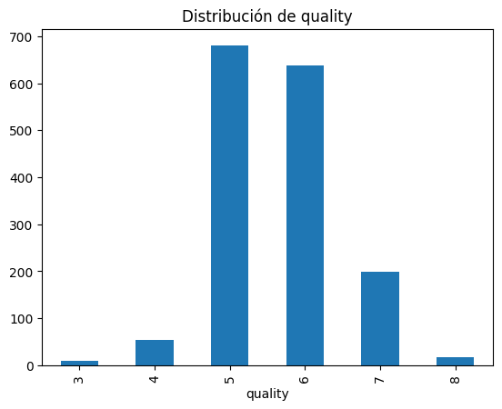
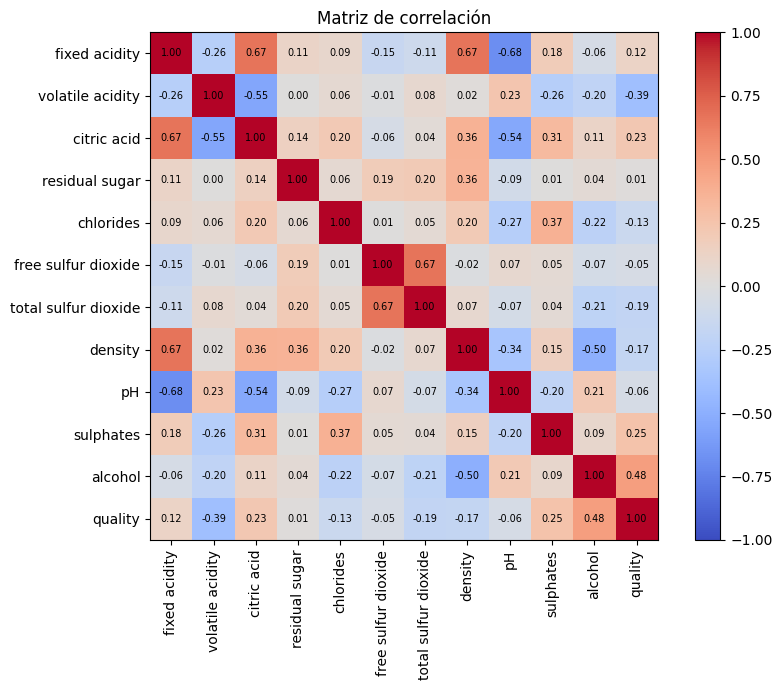
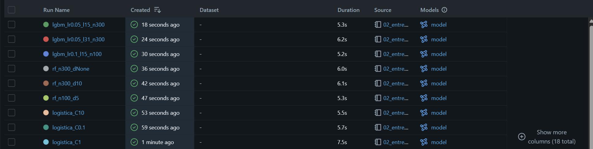
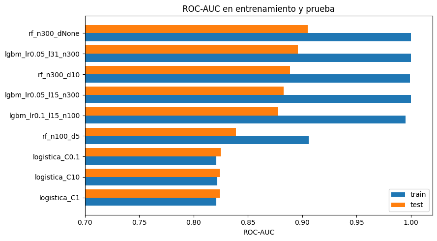

# TP Final 

**Nombree:** Eliana Gómez Coumroglon

**Variante elegida:** 2 – Ejecución, **Opción B** (Experimentación y comparación de modelos con MLflow)

## 1. Objetivo

Comparar modelos de aprendizaje automático para predecir si un vino tinto es de buena calidad a partir de sus características fisicoquímicas, registrando cada experimento en MLflow (parámetros, métricas y artefactos) sobre Databricks, y seleccionar la mejor alternativa de forma justificada.

## 2. Contenido de la carpeta

| Archivo | Descripción |
|---|---|
| `01_eda_y_preparacion` | Carga, análisis exploratorio, definición de la variable objetivo y partición train/test |
| `02_entrenamiento_mlflow` | Entrenamiento de 9 corridas (3 familias de modelos) con registro en MLflow |
| `03_comparacion_y_seleccion` | Tabla de corridas, gráfico comparativo, selección del modelo y limitaciones |
| `evidencia/` | Capturas: distribución de `quality`, matriz de correlación, lista de runs en MLflow y gráfico de ROC-AUC |

## 3. Datos

- **Fuente:** Wine Quality (vino tinto), UCI Machine Learning Repository. Disponible en Databricks en `/databricks-datasets/wine-quality/winequality-red.csv`.
- **Descripción:** 1.599 vinos *Vinho Verde* tintos, con 11 variables fisicoquímicas numéricas (`fixed acidity`, `volatile acidity`, `citric acid`, `residual sugar`, `chlorides`, `free sulfur dioxide`, `total sulfur dioxide`, `density`, `pH`, `sulphates`, `alcohol`) y el puntaje de calidad `quality`.
- **Variable objetivo:** `bueno = 1` si `quality >= 6`, `0` en caso contrario. Es un problema de clasificación binaria. Se eligió el umbral para obtener clases casi balanceadas (53,5 % buenos, 46,5 % no buenos).

## 4. Análisis exploratorio y preparación

- No hay valores nulos y todas las variables son numéricas.
- Hay 240 filas duplicadas (15 %), que se **conservaron** porque no existe un identificador que permita afirmar que sean registros repetidos y no vinos distintos con mediciones iguales.
- Las variables tienen escalas muy distintas, por lo que se estandarizan para la regresión logística (los árboles no lo requieren). Hay valores extremos que no se eliminaron.
- `quality` va de 3 a 8 y se concentra en 5 (42,6 %) y 6 (39,9 %); los extremos son muy escasos, por lo que se define una variable objetivo binaria.
- Las variables más asociadas a la calidad son `alcohol` (r = 0,48), `volatile acidity` (r = −0,39), `sulphates` (r = 0,25) y `citric acid` (r = 0,23). Existen correlaciones fuertes entre algunas predictoras (por ejemplo `fixed acidity` con `pH`, −0,68), que se conservan.
- **Partición:** 80 % entrenamiento (1.279 filas) y 20 % prueba (320 filas), estratificada por `bueno` y con `random_state=42`. Es la misma para todos los modelos.
- El dataset es pequeño, por lo que se convierte a pandas para usar scikit-learn. 

## 5. Modelos y registro en MLflow

Se entrenaron 9 corridas en el experimento `tp_final_vino`:

| Familia | Configuraciones |
|---|---|
| Regresión logística (con `StandardScaler`) | `C` = 0,1; 1; 10 |
| Random forest | (n_estimators, max_depth) = (100, 5), (300, 10), (300, sin límite) |
| LightGBM | (learning_rate, num_leaves, n_estimators) = (0,1; 15; 100), (0,05; 31; 300), (0,05; 15; 300) |

En cada corrida se registraron:
- **Parámetros:** modelo, hiperparámetros, tamaño de prueba y semilla.
- **Métricas:** accuracy, precision, recall, F1 y ROC-AUC en prueba, y ROC-AUC en entrenamiento.
- **Artefactos:** matriz de confusión y el modelo con su firma.

## 6. Resultados

Corridas ordenadas por ROC-AUC de prueba:

| Run | Accuracy | Precision | Recall | F1 | ROC-AUC | ROC-AUC train |
|---|---|---|---|---|---|---|
| rf_n300_dNone | 0,809 | 0,831 | 0,807 | 0,819 | **0,905** | 1,000 |
| lgbm_lr0.05_l31_n300 | **0,819** | **0,847** | 0,807 | **0,826** | 0,896 | 1,000 |
| rf_n300_d10 | 0,803 | 0,818 | 0,813 | 0,815 | 0,889 | 0,999 |
| lgbm_lr0.05_l15_n300 | 0,809 | 0,831 | 0,807 | 0,819 | 0,883 | 1,000 |
| lgbm_lr0.1_l15_n100 | 0,800 | 0,824 | 0,795 | 0,810 | 0,878 | 0,995 |
| rf_n100_d5 | 0,763 | 0,799 | 0,743 | 0,770 | 0,839 | 0,906 |
| logistica_C0.1 | 0,738 | 0,767 | 0,731 | 0,749 | 0,825 | 0,821 |
| logistica_C1 | 0,741 | 0,768 | 0,737 | 0,752 | 0,824 | 0,821 |
| logistica_C10 | 0,744 | 0,773 | 0,737 | 0,754 | 0,824 | 0,822 |

- Los modelos de árboles superan a la regresión logística en todas las métricas (ROC-AUC de prueba ≈ 0,88–0,91 frente a ≈ 0,82).
- La regresión logística rinde igual en entrenamiento y prueba (sin sobreajuste), pero es menos flexible. Los modelos de árboles presentan una brecha de ~0,10 entre ROC-AUC de entrenamiento y de prueba.

## 7. Evidencia

## 8. Selección del modelo

Se eligió como métrica principal el **ROC-AUC de prueba**, porque no depende de un umbral y las clases están casi balanceadas (F1 y accuracy se usan como apoyo). El modelo elegido es **`rf_n300_dNone`** (random forest, 300 árboles, sin límite de profundidad): ROC-AUC = 0,905, F1 = 0,819, accuracy = 0,809.

`lgbm_lr0.05_l31_n300` es el mejor en F1, accuracy y precision, y queda segundo en ROC-AUC. Con solo 320 observaciones de prueba, las diferencias entre ambos no son estadísticamente distinguibles, por lo que la elección entre ellos es de criterio.

## 9. Limitaciones

- **Partición única:** un solo conjunto de prueba de 320 filas y sin validación cruzada; las diferencias pequeñas entre modelos no son concluyentes.
- **Sobreajuste** en los modelos de árboles (brecha de ~0,10) no se aplicó regularización más fuerte.
- **Búsqueda acotada:** 3 configuraciones por familia, sin búsqueda exhaustiva de hiperparámetros.
- **Duplicados conservados:** al mantener las 240 filas duplicadas, una misma observación puede aparecer en entrenamiento y prueba, lo que podría inflar las métricas, sobre todo en los modelos de árboles.
- **Datos:** dataset pequeño, solo vino tinto, `quality` es un puntaje subjetivo y el umbral `>= 6` es arbitrario.
- **Alcance:** no se evaluó sobre datos nuevos ni se desplegó el modelo.

## 10. Referencias

- Cortez, P., Cerdeira, A., Almeida, F., Matos, T. y Reis, J. (2009). *Modeling wine preferences by data mining from physicochemical properties*. Decision Support Systems, 47(4), 547–553.
- UCI Machine Learning Repository: Wine Quality Data Set.
- Documentación de MLflow, scikit-learn y LightGBM.